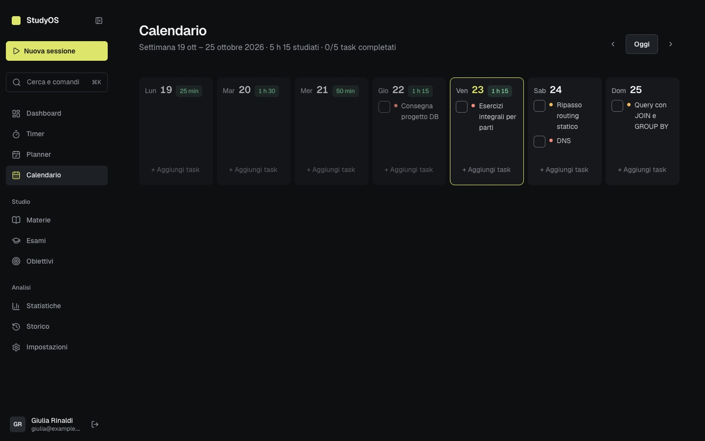
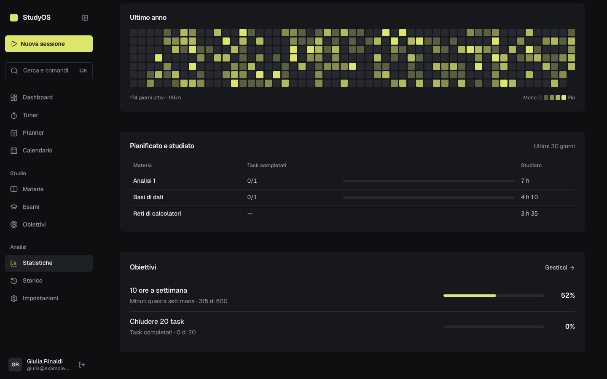
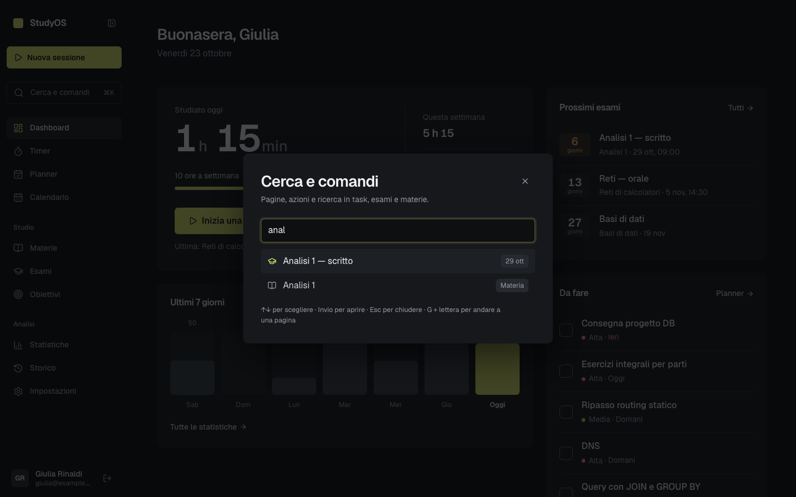
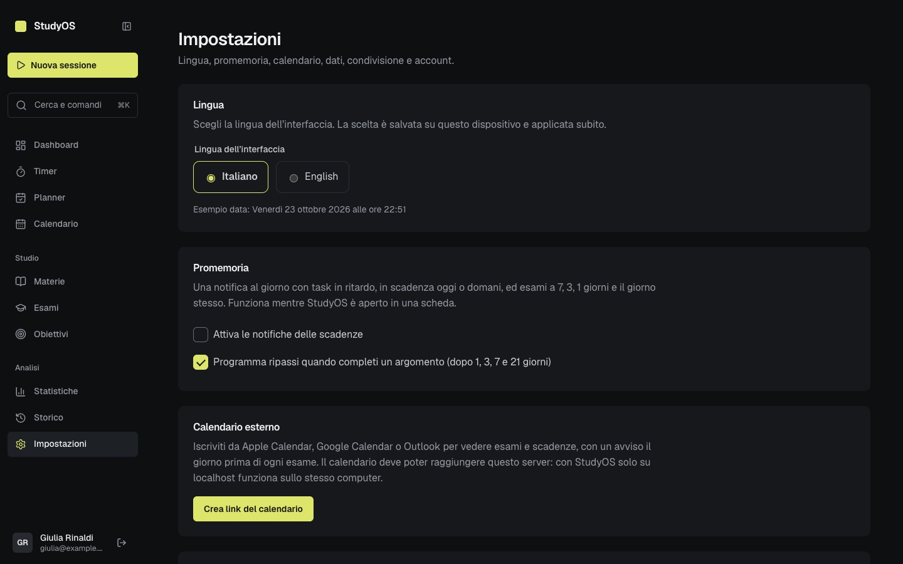
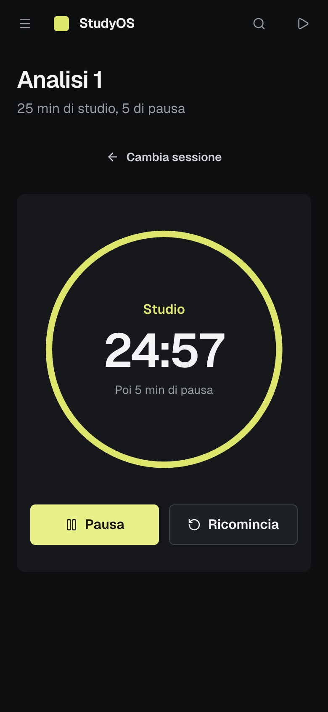

<!-- markdownlint-disable MD033 MD041 MD060 -->

<div align="center">

# 📚 StudyOS

## Il tuo sistema operativo per lo studio

**Pianifica. Studia. Traccia. Analizza. Migliora.** — tutto in un unico posto.

[](./compose.yaml)
[](./backend)
[](./frontend)
[](./frontend)
[](./database)
[](./LICENSE)

[English](./README.md) · **Italiano**

[🚀 Avvio rapido](#-avvio-rapido-3-minuti) · [✨ Funzionalità](#-funzionalità) · [🖼️ Screenshot](#️-screenshot) · [🛠️ Tecnologie](#️-tecnologie) · [📦 Struttura](#-struttura-del-progetto)

</div>

---

## 🎬 StudyOS in azione

<div align="center">


*Timer Pomodoro → sessione registrata → dashboard e statistiche aggiornate.*

</div>

> Non l'ennesimo timer. Non l'ennesima to-do list.  
> **StudyOS collega i piani alla realtà**: cosa avevi pianificato di studiare e cosa hai studiato davvero.

---

## ✨ Funzionalità

| | Area | Cosa fa |
|---|---|---|
| 📅 | **Planner** | Task con materia, argomento, priorità, scadenza e stato |
| ⏱️ | **Timer Pomodoro** | Continua a girare tra le pagine e salva la sessione a fine blocco |
| 📚 | **Materie e argomenti** | Gerarchia `Materia → Argomento` con note Markdown per argomento e ripassi automatici (+1/3/7/21 giorni) |
| 📝 | **Esami** | Conto alla rovescia, piano di studio fino all'esame con un clic, voti e CFU con media ponderata e base di laurea |
| 🎯 | **Obiettivi** | Minuti settimanali/totali, task, argomenti, sessioni — progresso calcolato dai dati reali |
| 📊 | **Statistiche** | Totali, tempo per materia/argomento, giorni di fila, heatmap annuale, pianificato vs studiato per materia |
| 🕘 | **Storico** | Sessioni raggruppate per giorno con i totali |
| 🗓️ | **Calendario** | Vista settimanale di esami, scadenze e minuti studiati; feed iCal per Apple/Google Calendar e Outlook |
| 💾 | **Backup** | Export JSON di tutti i dati con un clic; l'import aggiunge un backup ai dati esistenti |
| 🔔 | **Promemoria** | Notifica giornaliera del browser per task in ritardo/in scadenza ed esami a 7/3/1/0 giorni |
| 🔗 | **Condivisione** | Link in sola lettura e revocabile al tuo piano di studio (niente note, luoghi o email) |
| ⌨️ | **Palette dei comandi** | `⌘K` / `Ctrl+K` per cercare task, esami e argomenti; `g` + lettera per cambiare pagina, `n` per un nuovo task |
| 🧠 | **Note in Synapse** | Esporta le note degli argomenti come vault Markdown collegato per [Synapse](https://github.com/Sero3105/Synapse) |
| 🔐 | **Account** | Registrazione/login, refresh via cookie, cambio password, cancellazione dell'account |

### 🔄 Il ciclo di StudyOS

```text
PIANIFICA → STUDIA → TRACCIA → ANALIZZA → MIGLIORA → PIANIFICA (di nuovo, meglio)
```

Ogni parte alimenta la successiva: un task porta a una sessione, la sessione alimenta le statistiche, le statistiche aiutano a migliorare il piano.

<div align="center">


*La dashboard: focus di oggi, scadenze, statistiche compatte e attività recente.*

</div>

---

## 🖼️ Screenshot

| Timer Pomodoro | Calendario | Materie e note |
|---|---|---|
|  |  |  |

| Esami e libretto | Statistiche | Heatmap annuale |
|---|---|---|
|  |  |  |

| Planner | Palette dei comandi | Obiettivi |
|---|---|---|
|  |  |  |

| Storico | Impostazioni | Login |
|---|---|---|
|  |  |  |

| Dashboard mobile | Timer mobile |
|---|---|
|  |  |

> 📁 Tutte le immagini sono in [`docs/media/`](./docs/media). Video demo: [`demo.mp4`](./docs/media/demo.mp4).

---

## 🚀 Avvio rapido (3 minuti)

Serve solo **Docker**. Non serve installare Python né Node.

```bash
cp .env.example .env
python3 -c "import secrets; print(secrets.token_urlsafe(48))"  # → incollalo come SECRET_KEY in .env
docker compose up --build -d
```

Apri **<http://localhost:8080>** e crea un account. Fatto. 🎉

```bash
docker compose up -d        # avvia
docker compose down         # ferma (i dati restano al sicuro nel volume)
docker compose logs -f api  # log del backend (web per nginx)
```

> ⚠️ Non usare `docker compose down -v` nella routine: cancella il volume con tutti gli utenti e le sessioni.

<details>
<summary><strong>🐳 Dettagli su Docker, backup e configurazione</strong></summary>

### Cosa gira

| Servizio | Immagine | Ruolo | Porta |
|---|---|---|---|
| `web` | nginx unprivileged (Alpine) | Serve il frontend e inoltra `/api/*` al backend | `127.0.0.1:8080` (unica porta pubblicata) |
| `api` | Python 3.14 slim | FastAPI + SQLAlchemy, un solo processo uvicorn, SQLite incluso | Solo rete interna |

Non c'è un container database: SQLite è un file nel volume `studyos-data` (`/data` in `api`). Il browser parla solo con `http://localhost:8080`, quindi non serve CORS e i cookie di autenticazione funzionano.

### Dati e backup

- **Docker:** volume `studyos_studyos-data`, montato su `/data/studyos.db` in `api`. Sopravvive a `down`, riavvii e rebuild.
- **Sviluppo locale:** `database/studyos.db` nel repository. Docker non lo tocca mai.

Il modo più semplice per un backup è **Impostazioni → Scarica backup** nell'app. Per copiare l'intero file del database:

```bash
# Backup del database Docker
docker compose exec -T api python -c "import sqlite3; sqlite3.connect('/data/studyos.db').backup(sqlite3.connect('/tmp/backup.db'))"
docker compose exec -T api cat /tmp/backup.db > studyos-backup.db

# Import una tantum del database locale (prima del primo avvio, con volume vuoto)
docker compose build
docker compose run --rm --no-deps -T api sh -c 'test ! -e /data/studyos.db && cat > /data/studyos.db' < database/studyos.db
docker compose up -d

# Reset voluto (cancella tutto — fai prima un backup!)
docker compose down
docker volume rm studyos_studyos-data
docker compose up -d
```

### Configurazione (`.env`)

| Variabile | Default | Note |
|---|---|---|
| `SECRET_KEY` | — (obbligatoria) | Almeno 32 caratteri casuali, diversa per ogni installazione |
| `APP_ENV` | `development` | `production` = cookie `Secure`, solo HTTPS, niente `/docs` |
| `ACCESS_TOKEN_EXPIRE_MINUTES` / `REFRESH_TOKEN_EXPIRE_DAYS` | `30` / `7` | |
| `STUDYOS_PORT` | `8080` | Legata a 127.0.0.1 |
| `STUDYOS_ORIGIN` | `http://localhost:<porta>` | Origine pubblica, se diversa |
| `API_MEMORY_LIMIT` / `API_CPUS` | `256M` / `1.0` | Limiti del container |
| `WEB_MEMORY_LIMIT` / `WEB_CPUS` | `64M` / `0.5` | Limiti del container |

**Sicurezza:** nginx limita `/api/auth/login` e `/api/auth/register` (10 al minuto per IP). I link di condivisione sono token casuali a 256 bit salvati solo come hash; rigenerare o disattivare un link invalida quello vecchio.

**HTTPS:** la configurazione di default usa HTTP su localhost. In produzione metti davanti un proxy TLS, imposta `APP_ENV=production` e configura `STUDYOS_ORIGIN=https://…`.

</details>

---

## 🛠️ Tecnologie

| Livello | Tecnologie |
|---|---|
| **Frontend** | React 19 · TypeScript · Vite · React Router · lucide-react · CSS puro con design token |
| **Backend** | FastAPI · SQLAlchemy · Alembic · Pydantic · PyJWT · pwdlib (argon2) · uvicorn |
| **Database** | SQLite (file nel volume Docker, `database/studyos.db` in locale) |
| **Deploy** | Docker Compose · nginx (file statici + proxy `/api`) · immagini multi-stage |

**Design:** dark-first, superfici quasi nere, un solo accento lime, piatto (niente gradienti), transizioni da 160 ms, `prefers-reduced-motion` rispettato, target touch da 44 px, breakpoint a 700/900 px. I token sono in `frontend/src/styles/base/tokens.css`.

---

## 📦 Struttura del progetto

```text
StudyOS/
├── compose.yaml          # setup di produzione (nginx + api)
├── .env.example          # modello delle variabili d'ambiente
├── backend/
│   ├── main.py           # entry point FastAPI + registrazione dei router
│   ├── config.py / database.py
│   ├── models/           # tabelle SQLAlchemy
│   ├── schemas/          # validazione Pydantic
│   ├── services/         # logica di business
│   ├── routers/          # endpoint HTTP (solo orchestrazione)
│   ├── migrations/       # migrazioni dello schema con Alembic
│   └── tests/            # pytest con database SQLite temporaneo
├── frontend/
│   └── src/
│       ├── pages/        # dashboard, timer, planner, calendario, materie, esami, obiettivi, storico, statistiche, impostazioni, piano condiviso
│       ├── components/   # sidebar, Pomodoro, form, UI kit
│       ├── context/      # auth + timer persistente
│       └── styles/       # base / layout / componenti / schermate
├── database/             # studyos.db locale (mai toccato da Docker)
└── docs/                 # screenshot, demo, note di design
```

**Regola d'oro:** i router orchestrano, i service contengono la logica, gli schema validano. Vedi [`DEVELOPMENT_GUIDE.md`](./DEVELOPMENT_GUIDE.md) per i dettagli.

### Sviluppo locale (hot reload)

Lancia questi comandi in terminali separati dalla root del repository:

```bash
cd backend
pip install -r requirements-dev.txt
uvicorn main:app --reload
```

```bash
cd frontend
npm install
npm run dev
```

Test del backend: `python -m pytest backend/tests/ -q`

**Migrazioni del database (Alembic).** L'API applica le migrazioni mancanti all'avvio, anche sui database creati prima dell'introduzione di Alembic. Dopo aver modificato un modello in `backend/models/`:

```bash
cd backend
alembic revision --autogenerate -m "descrivi la modifica"   # controlla il file generato in migrations/versions/
```

---

## 🗺️ Roadmap

- [x] Autenticazione, materie/argomenti, task, esami, sessioni, obiettivi, statistiche
- [x] Calendario integrato e pianificazione settimanale
- [x] Import/export dei dati e backup con un clic
- [x] Notifiche delle scadenze e promemoria intelligenti
- [x] Condivisione del piano di studio
- [x] Feed iCal, ripassi a intervalli, piani di studio per gli esami
- [x] Palette dei comandi e scorciatoie da tastiera
- [x] Voti, CFU e base di laurea
- [x] Note per argomento con export per Synapse
- [x] Heatmap annuale e pianificato vs studiato
- [x] Cambio password e cancellazione dell'account

---

## 🔒 Sicurezza e licenza

Hai trovato una vulnerabilità? Segnalala in privato — vedi [`SECURITY.md`](./SECURITY.md).

StudyOS è distribuito con [licenza MIT](./LICENSE).

---

<div align="center">

**StudyOS — studia per capire, non solo per misurare.**

*Se ti aiuta a studiare meglio, lascia una ⭐ — fa crescere il progetto.*

</div>
