<!-- markdownlint-disable MD033 MD041 MD060 -->

<div align="center">

# 📚 StudyOS

## Your operating system for studying

**Plan. Study. Track. Analyze. Improve.** — all in one place.

[](./compose.yaml)
[](./backend)
[](./frontend)
[](./frontend)
[](./database)

[🚀 Quickstart](#-quickstart-3-minutes) · [✨ Features](#-features) · [🖼️ Screenshots](#️-screenshots) · [🛠️ Tech Stack](#️-tech-stack) · [📦 Project Structure](#-project-structure)

</div>

---

## 🎬 See StudyOS in action

<div align="center">

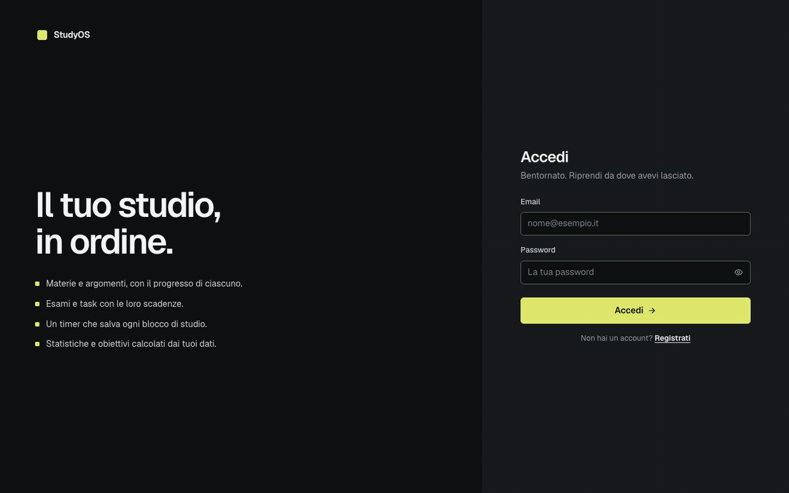

*Pomodoro timer → session recorded → dashboard and statistics updated.*

</div>

> Not just another timer. Not just another to-do list.  
> **StudyOS connects plans with reality**: what you planned to study versus what you actually studied.

---

## ✨ Features

| | Area | What it does |
|---|---|---|
| 📅 | **Planner** | Tasks with subject, topic, priority, deadlines, and status |
| ⏱️ | **Pomodoro Timer** | Keeps running across pages and saves the session when a focus block ends |
| 📚 | **Subjects & Topics** | `Subject → Topic` hierarchy connected to sessions and progress |
| 📝 | **Exams** | Full CRUD with deadlines and countdowns |
| 🎯 | **Goals** | Weekly/total minutes, tasks, topics, sessions — progress calculated from real data |
| 📊 | **Statistics** | Total time, time by subject/topic, daily/weekly/monthly activity, streaks |
| 🕘 | **History** | Sessions grouped by day with totals |
| 🗓️ | **Calendar** | Weekly view of exams, task deadlines and minutes studied; add tasks straight to a day |
| 💾 | **Backups** | One-click JSON export of all your data; import adds a backup back in |
| 🔔 | **Reminders** | Daily browser notification for overdue/upcoming tasks and exams at 7/3/1/0 days |
| 🔗 | **Sharing** | Revocable read-only link to your study plan (no notes, locations or email) |
| 🔐 | **Auth** | Registration/login, cookie-based refresh, session restored on page reload |

### 🔄 The StudyOS cycle

```text
PLAN → STUDY → TRACK → ANALYZE → IMPROVE → PLAN (again, better)
```

Each part feeds the next: a task leads to a session, the session powers the statistics, and the statistics help improve the plan.

<div align="center">

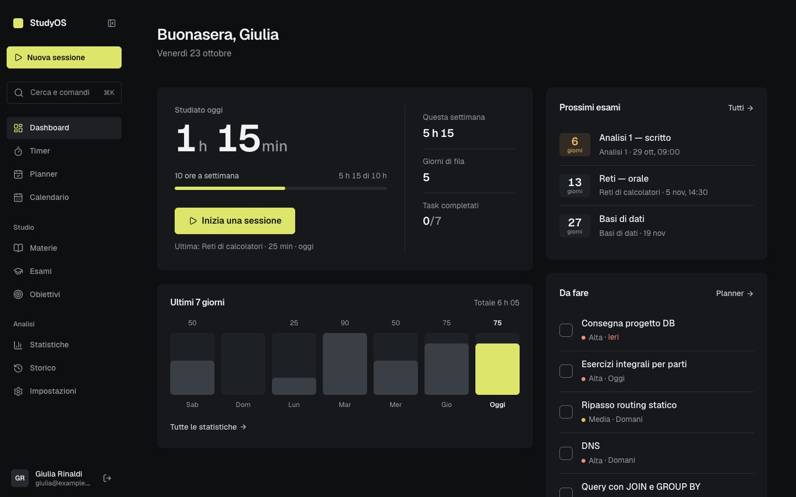

*The dashboard: today's focus, deadlines, compact statistics, and recent activity.*

</div>

---

## 🖼️ Screenshots

| Pomodoro Timer | Statistics | Subjects |
|---|---|---|
| 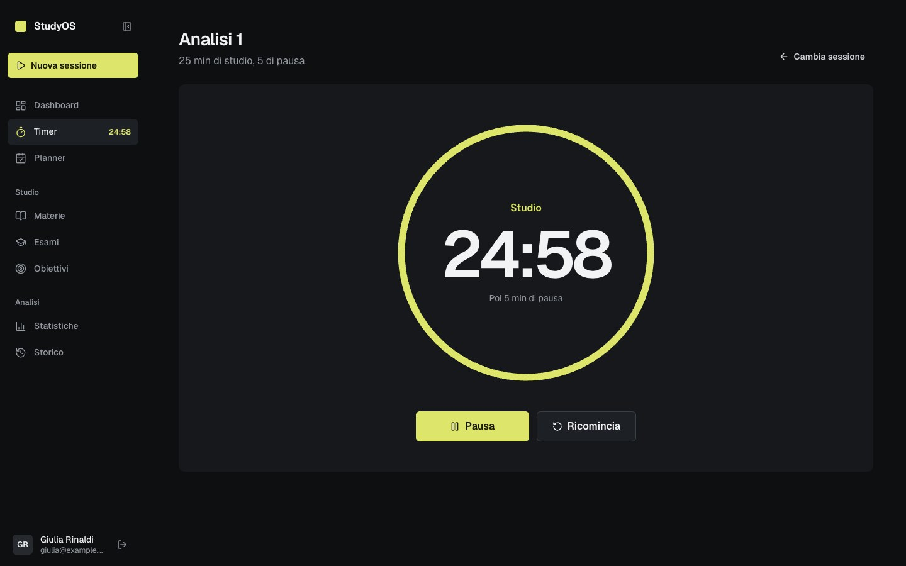 | 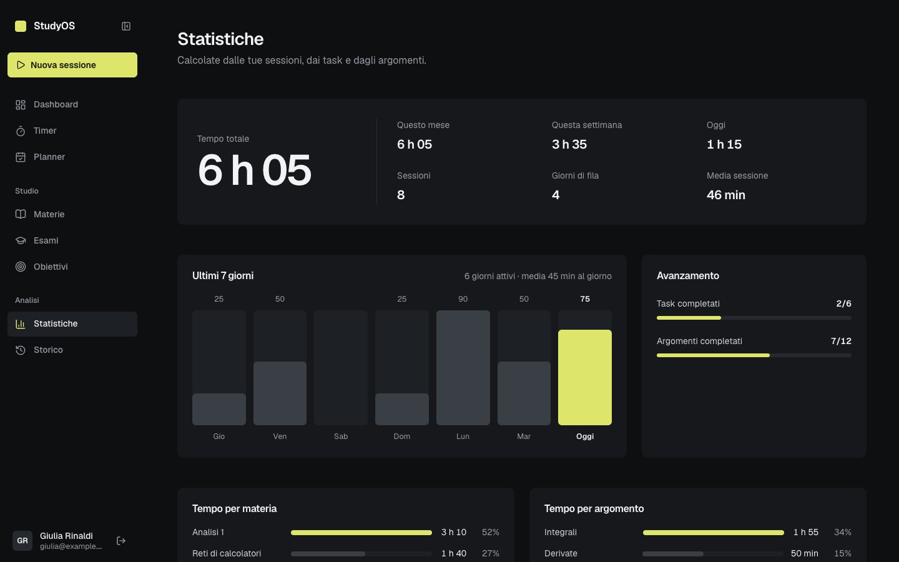 | 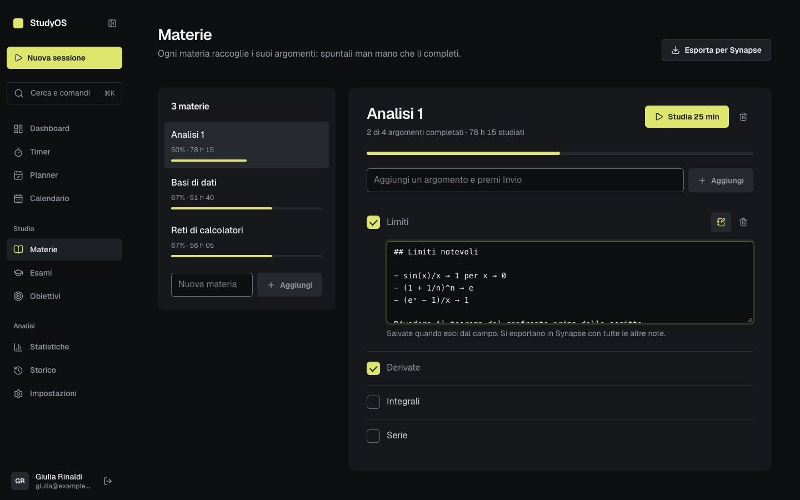 |

| Planner | Exams | Goals |
|---|---|---|
| 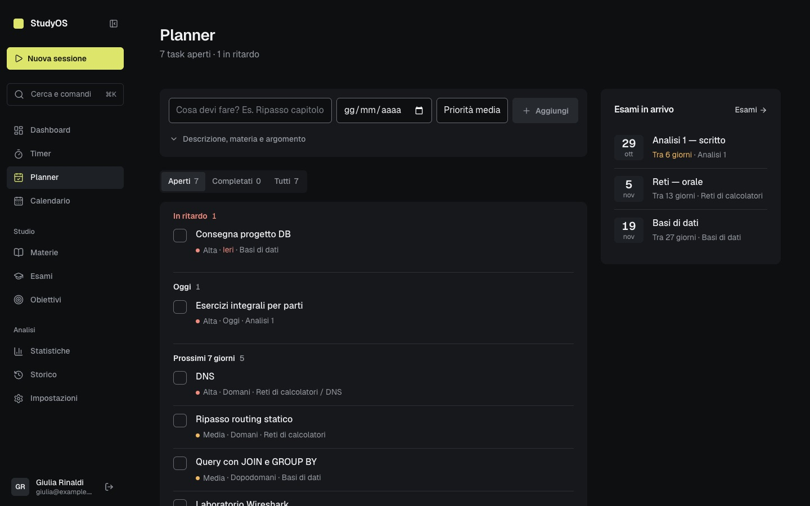 | 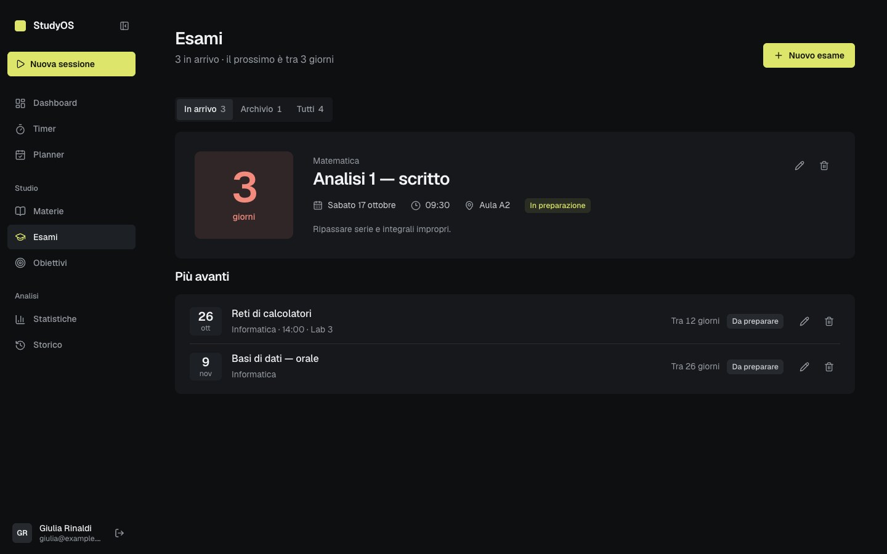 | 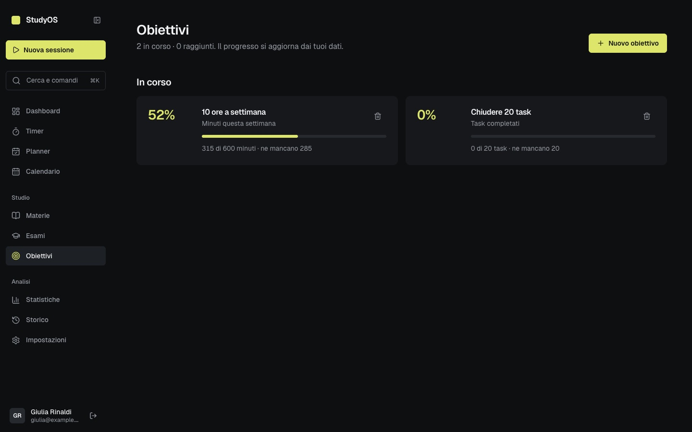 |

| History | Login | Mobile |
|---|---|---|
| 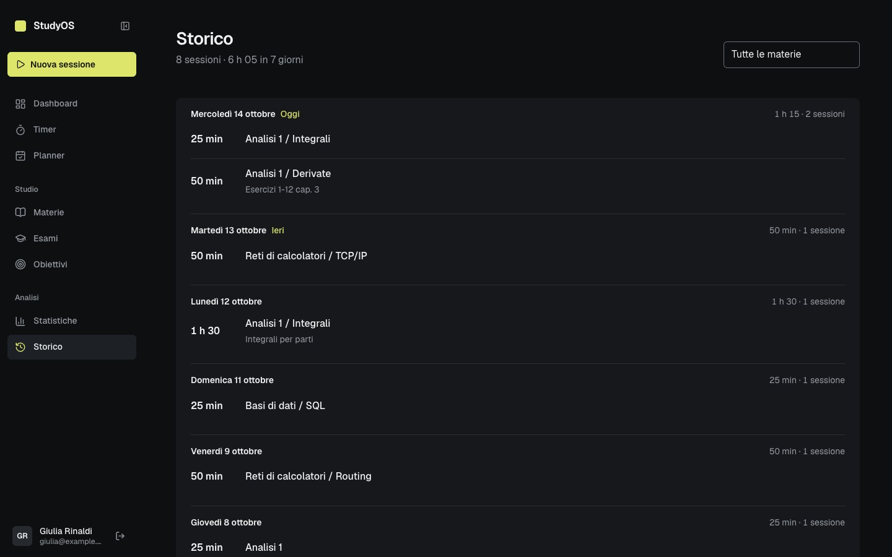 | 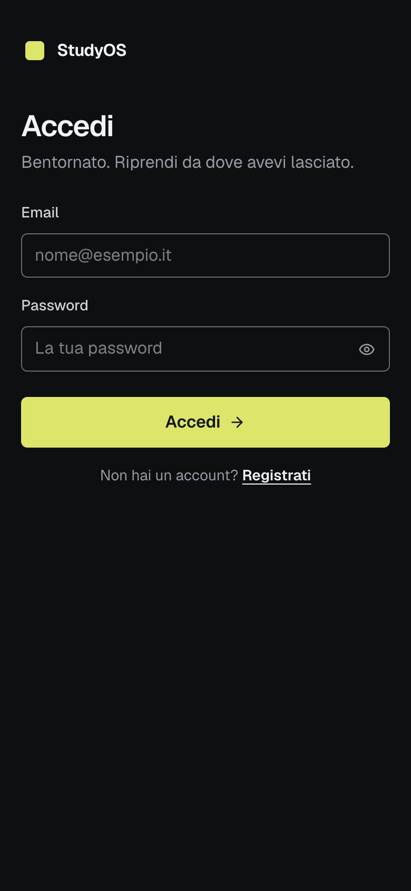 | 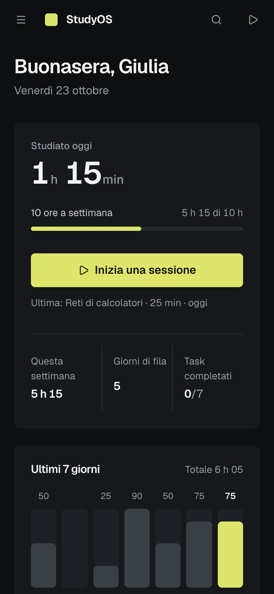 |

> 📁 All images are in [`docs/media/`](./docs/media). Demo video: [`demo.mp4`](./docs/media/demo.mp4).

---

## 🚀 Quickstart (3 minutes)

All you need is **Docker**. No Python or Node installation required.

```bash
cp .env.example .env
python3 -c "import secrets; print(secrets.token_urlsafe(48))"  # → paste as SECRET_KEY in .env
docker compose up --build -d
```

Open **<http://localhost:8080>** and create an account. That’s it. 🎉

```bash
docker compose up -d        # start
docker compose down         # stop (data remains safe in the volume)
docker compose logs -f api  # backend logs (web for nginx)
```

> ⚠️ Don’t use `docker compose down -v` as part of your regular workflow: it deletes the volume containing all users and sessions.

<details>
<summary><strong>🐳 Docker, backups, and configuration details</strong></summary>

### What runs

| Service | Image | Role | Port |
|---|---|---|---|
| `web` | nginx unprivileged (Alpine) | Serves the frontend and forwards `/api/*` to the backend | `127.0.0.1:8080` (only published port) |
| `api` | Python 3.14 slim | FastAPI + SQLAlchemy, one uvicorn process, SQLite included | Internal network only |

There is no database container: SQLite is a file in the `studyos-data` volume (`/data` in `api`). The browser communicates only with `http://localhost:8080`, so no CORS is needed and auth cookies work.

### Data and backups

- **Docker:** volume `studyos_studyos-data`, mounted at `/data/studyos.db` in `api`. It survives `down`, restarts, and rebuilds.
- **Local development:** `database/studyos.db` in the repository. Docker never touches it.

```bash
# Back up the Docker database
docker compose exec -T api python -c "import sqlite3; sqlite3.connect('/data/studyos.db').backup(sqlite3.connect('/tmp/backup.db'))"
docker compose exec -T api cat /tmp/backup.db > studyos-backup.db

# One-time import of the local database (before first startup, with an empty volume)
docker compose build
docker compose run --rm --no-deps -T api sh -c 'test ! -e /data/studyos.db && cat > /data/studyos.db' < database/studyos.db
docker compose up -d

# Intentional reset (deletes everything — back up first!)
docker compose down
docker volume rm studyos_studyos-data
docker compose up -d
```

### Configuration (`.env`)

| Variable | Default | Notes |
|---|---|---|
| `SECRET_KEY` | — (required) | At least 32 random characters, unique to each installation |
| `APP_ENV` | `development` | `production` = `Secure` cookies, HTTPS only |
| `ACCESS_TOKEN_EXPIRE_MINUTES` / `REFRESH_TOKEN_EXPIRE_DAYS` | `30` / `7` | |
| `STUDYOS_PORT` | `8080` | Bound to 127.0.0.1 |
| `STUDYOS_ORIGIN` | `http://localhost:<port>` | Public origin if different |
| `API_MEMORY_LIMIT` / `API_CPUS` | `256M` / `1.0` | Container limits |
| `WEB_MEMORY_LIMIT` / `WEB_CPUS` | `64M` / `0.5` | Container limits |

**Security:** nginx rate-limits `/api/auth/login` and `/api/auth/register` (10/min per IP). Share links are random 256-bit tokens stored only as hashes; regenerating or disabling a link invalidates the old one.

**HTTPS:** The default setup uses HTTP on localhost. In production, put a TLS proxy in front, set `APP_ENV=production`, and configure `STUDYOS_ORIGIN=https://…`.

</details>

---

## 🛠️ Tech stack

| Layer | Technologies |
|---|---|
| **Frontend** | React 19 · TypeScript · Vite · React Router · lucide-react · vanilla CSS with design tokens |
| **Backend** | FastAPI · SQLAlchemy · Pydantic · PyJWT · pwdlib (argon2) · uvicorn |
| **Database** | SQLite (file in the Docker volume, `database/studyos.db` locally) |
| **Deployment** | Docker Compose · nginx (static files + `/api` proxy) · multi-stage images |

**Design:** dark-first, near-black surfaces, a single purple accent, flat (no gradients), 160 ms transitions, `prefers-reduced-motion` respected, 44 px touch targets, 700/900 px breakpoints. Tokens are in `frontend/src/styles/base/tokens.css`.

---

## 📦 Project structure

```text
StudyOS/
├── compose.yaml          # production setup (nginx + api)
├── .env.example          # environment variable template
├── backend/
│   ├── main.py           # FastAPI entry point + router mounting
│   ├── config.py / database.py
│   ├── models/           # SQLAlchemy tables
│   ├── schemas/          # Pydantic validation
│   ├── services/         # business logic
│   ├── routers/          # HTTP endpoints (orchestration only)
│   └── tests/            # pytest with temporary SQLite database
├── frontend/
│   └── src/
│       ├── pages/        # dashboard, timer, planner, subjects, exams, goals, history, statistics
│       ├── components/   # sidebar, Pomodoro, forms, UI kit
│       ├── context/      # auth + persistent timer
│       └── styles/       # base / layout / components / screens
├── database/             # local studyos.db (never touched by Docker)
└── docs/media/           # screenshots + demo
```

**Golden rule:** routers orchestrate, services handle logic, schemas validate. See [`DEVELOPMENT_GUIDE.md`](./DEVELOPMENT_GUIDE.md) for details.

### Local development (hot reload)

Run these commands in separate terminals from the repository root:

```bash
cd backend
pip install -r requirements-dev.txt
uvicorn main:app --reload
```

```bash
cd frontend
npm install
npm run dev
```

Backend tests: `python -m pytest backend/tests/ -q`

---

## 🗺️ Roadmap

- [x] Auth, subjects/topics, tasks, exams, sessions, goals, statistics
- [x] Integrated calendar and weekly planning
- [x] Data import/export and one-click backups
- [x] Deadline notifications and smart reminders
- [x] Study plan sharing

---

<div align="center">

**StudyOS — study so you can understand, not just measure.**

*If it helps you study better, leave a ⭐ — it keeps the project going.*

</div>
