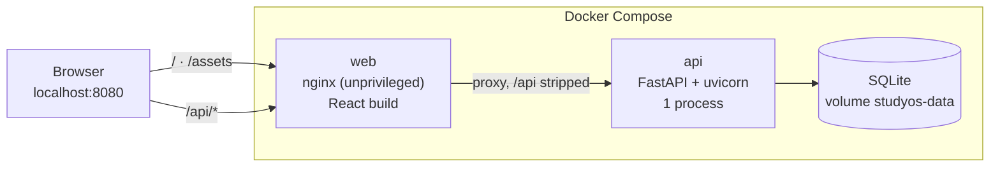

<div align="center">


# StudyOS

**Plan your study. Track what you do. Understand your progress.**

A personal study operating system: subjects, exams, tasks, a focus timer and statistics in one calm, dark workspace.

[](https://react.dev)
[](https://www.typescriptlang.org)
[](https://vite.dev)
[](https://fastapi.tiangolo.com)
[](https://sqlite.org)
[](#-quick-start-with-docker)

[Features](#-features) · [Screenshots](#-screenshots) · [Quick start](#-quick-start-with-docker) · [Architecture](#-architecture) · [Development](#-local-development) · [Docker reference](#-docker-reference)

<br />


<sub>Real recording of the app running in Docker, with demo data. <a href="docs/media/demo.mp4">Watch the MP4</a>.</sub>

</div>

---

## 💡 Why StudyOS

A timer tells you that you studied for two hours. A to-do list tells you that three assignments are left. A calendar tells you that an exam is next week.

StudyOS connects these into one picture, so studying becomes something you can **understand**, not just measure:

> **Plan → Study → Track → Analyze → Improve**

A task leads to a study session, the session adds to your progress, progress becomes statistics, and statistics shape the next plan.

## ✨ Features

| | |
| --- | --- |
| 🏠 **Dashboard** | Today's study time, weekly goal, exam countdowns colored by urgency, and open tasks you can tick off in place. |
| ⏱️ **Focus timer** | Pomodoro presets (25+5, 50+10, 90+15) or custom times, linked to a subject and topic. It keeps running while you move around the app, and every completed block is saved to your history. |
| 📅 **Planner** | Quick-add tasks with deadline and priority, grouped into *Overdue / Today / Next 7 days / Later*. |
| 🎓 **Exams** | The next exam front and center with a day countdown; the rest in a compact timeline; past ones archived with their result. |
| 📚 **Subjects & topics** | Master-detail view with progress per subject, time studied, and a one-click "study this now". |
| 🎯 **Goals** | Measurable targets (weekly minutes, sessions, topics, tasks) whose progress is computed from your real data. |
| 📊 **Statistics & history** | Totals, a 7-day chart, time per subject and per topic, and a day-by-day session log with filters. |
| 🔐 **Secure auth** | Short-lived JWT access tokens, an HttpOnly refresh cookie with rotation, CSRF protection, and argon2 password hashing. |
| 📱 **Responsive & accessible** | Works from 320 px phones to wide desktops; keyboard-friendly dialogs, visible focus, WCAG AA contrast, reduced motion. |

## 📸 Screenshots

<table>
  <tr>
    <td width="50%"><p align="center"><b>Dashboard</b>: today, attention, rhythm</p></td>
    <td width="50%"><p align="center"><b>Timer</b>: one focal point, nothing else</p></td>
  </tr>
  <tr>
    <td><p align="center"><b>Planner</b>: tasks grouped by deadline</p></td>
    <td><p align="center"><b>Exams</b>: the next one, in big numbers</p></td>
  </tr>
  <tr>
    <td><p align="center"><b>Subjects</b>: topics and progress</p></td>
    <td><p align="center"><b>Statistics</b>: where your time goes</p></td>
  </tr>
  <tr>
    <td><p align="center"><b>Goals</b>: progress from real data</p></td>
    <td><p align="center"><b>History</b>: every session, by day</p></td>
  </tr>
</table>

<details>
<summary><b>📱 Mobile and sign-in</b></summary>
<br />
<p align="center">
  
  &nbsp;&nbsp;
  
</p>
<p align="center"></p>
</details>

<sub>Screenshots use fictional demo data.</sub>

## 🚀 Quick start with Docker

You only need [Docker Desktop](https://www.docker.com/products/docker-desktop/) (or Docker Engine with Compose). No Python, no Node.js.

```bash
git clone https://github.com/Sero3105/studyOS.git
cd studyOS
cp .env.example .env
python3 -c "import secrets; print(secrets.token_urlsafe(48))"   # paste the output as SECRET_KEY in .env
docker compose up --build -d
```

Open **http://localhost:8080** and create your account. To stop it: `docker compose down`. Your data stays (details in the [Docker reference](#-docker-reference)).

## 🧭 Architecture



| Layer | Stack |
| --- | --- |
| Frontend | React 19, TypeScript, Vite, React Router, lucide-react, plain CSS with central design tokens, self-hosted Geist font |
| Backend | FastAPI, SQLAlchemy 2, Pydantic 2, PyJWT, pwdlib (argon2) |
| Database | SQLite, a single file, in a Docker volume or in `database/` locally |
| Delivery | Multi-stage Docker images, nginx reverse proxy, Docker Compose |

<details>
<summary><b>📁 Project structure</b></summary>

```text
studyOS/
├── compose.yaml            # Docker: web + api + data volume
├── .env.example            # configuration template (copy to .env)
├── backend/
│   ├── main.py             # FastAPI app, CORS, routers
│   ├── config.py           # environment and security validation
│   ├── routers/            # auth, exams, subjects, tasks, sessions, goals, stats
│   ├── services/ models/ schemas/
│   ├── tests/              # pytest suite
│   └── Dockerfile
├── frontend/
│   ├── src/
│   │   ├── pages/          # one file per screen
│   │   ├── components/     # shared UI kit, timer, dashboard, exams
│   │   ├── context/        # auth and timer providers
│   │   ├── services/       # typed API client
│   │   └── styles/         # tokens, base, layout, components, screens
│   ├── nginx.conf
│   └── Dockerfile
└── docs/media/             # README screenshots and demo
```

</details>

## 🛠️ Local development

Hot reload, without Docker:

```bash
# Backend: http://127.0.0.1:8000
cd backend
python -m venv .venv && source .venv/bin/activate
pip install -r requirements-dev.txt
uvicorn main:app --reload

# Frontend: http://localhost:5173 (in a second terminal)
cd frontend
npm install
npm run dev
```

Checks: `npm run lint` and `npm run build` in `frontend/`, `pytest` in `backend/`. See [`DEVELOPMENT_GUIDE.md`](DEVELOPMENT_GUIDE.md) (in Italian) for conventions.

## 🗺️ Vision

The long-term goal is a complete personal **study operating system**, where planning (tasks, goals, calendar), tracking (sessions, time, activity) and analytics (statistics, progress, trends) are all connected, and every part of the study process feeds the others.

---

## 🐳 Docker reference

### What runs

| Service | Image | Role | Port |
| --- | --- | --- | --- |
| `web` | nginx (unprivileged, Alpine) | Serves the built frontend and forwards `/api/*` to the backend | `127.0.0.1:8080` (the only published port) |
| `api` | Python 3.14 slim | FastAPI + SQLAlchemy, one uvicorn process; SQLite runs inside it | internal only |

There is no database container. SQLite is a file inside the named volume `studyos-data`, mounted at `/data` in `api`. The browser only talks to `http://localhost:8080`. API calls go to `/api/...` on the same origin, so no CORS is involved and the auth cookies work unchanged. nginx rewrites the refresh cookie path from `/auth` to `/api/auth`.

### Everyday commands

```bash
docker compose up -d              # start (after the first build)
docker compose down               # stop and remove containers; data stays in the volume
docker compose up --build -d      # rebuild images after code changes; data stays
docker compose ps                 # status and health
docker compose logs -f api        # follow backend logs (web for nginx)
docker stats                      # live RAM/CPU per container
docker image ls studyos-*         # image sizes
```

> ⚠️ Never use `docker compose down -v` for routine work: `-v` deletes the `studyos-data` volume, and with it every user and every study session.

### Where the data lives

- **Docker:** in the named volume `studyos_studyos-data`, at `/data/studyos.db` inside `api`. The volume survives `down`, restarts, container recreation and image rebuilds.
- **Local development:** `database/studyos.db` in the repository. Docker never reads or writes this file.

**Back up the Docker database**

```bash
docker compose exec -T api python -c "import sqlite3; sqlite3.connect('/data/studyos.db').backup(sqlite3.connect('/tmp/backup.db'))"
docker compose exec -T api cat /tmp/backup.db > studyos-backup.db
```

**Import an existing local database (explicit, one time).** Docker never copies your personal database automatically. To move `database/studyos.db` into Docker, do it **before the first start**, so the volume is still empty:

```bash
docker compose build
docker compose run --rm --no-deps -T api sh -c 'test ! -e /data/studyos.db && cat > /data/studyos.db' < database/studyos.db
docker compose up -d
```

The `test ! -e` guard refuses to overwrite a database that already exists in the volume. If Docker has already created one, back it up first, then reset the volume as described below.

**Reset a disposable database.** This deletes all Docker data on purpose, so back up first if anything matters.

```bash
docker compose down
docker volume rm studyos_studyos-data
docker compose up -d
```

### Configuration

All values come from `.env` (see `.env.example`):

| Variable | Default | Notes |
| --- | --- | --- |
| `SECRET_KEY` | — (required) | At least 32 random characters, unique per installation. Compose refuses to start without it; the backend refuses the placeholder |
| `APP_ENV` | `development` | `production` marks cookies `Secure`: use it only behind HTTPS |
| `ACCESS_TOKEN_EXPIRE_MINUTES` / `REFRESH_TOKEN_EXPIRE_DAYS` | `30` / `7` | |
| `STUDYOS_PORT` | `8080` | Host port, bound to 127.0.0.1 only |
| `STUDYOS_ORIGIN` | `http://localhost:<port>` | Public origin, if StudyOS is served elsewhere |
| `API_MEMORY_LIMIT` / `API_CPUS` | `256M` / `1.0` | Container limits |
| `WEB_MEMORY_LIMIT` / `WEB_CPUS` | `64M` / `0.5` | Container limits |

In Docker, `DATABASE_URL` and `FRONTEND_ORIGINS` are set by `compose.yaml`; the `DATABASE_URL` in your `.env` is only for local development. `.env` is git-ignored and never copied into an image.

**HTTPS:** the default setup is plain HTTP on localhost, intended for local use. For a real deployment, put StudyOS behind a TLS-terminating proxy, set `APP_ENV=production` and set `STUDYOS_ORIGIN` to the `https://` address.

### Resources

Measured with `docker stats` on Docker Desktop (Apple Silicon):

| Container | Image size | RAM idle | RAM under load* |
| --- | --- | --- | --- |
| `api` | 272 MB | ~72 MiB | ~76 MiB |
| `web` | 31 MB | ~5 MiB | ~5 MiB |

<sub>* 3,000 authenticated API requests, 8 in parallel. Image size is as reported by `docker image ls` with the containerd image store.</sub>

- Builds are multi-stage. Node, `node_modules`, TypeScript, pip and tests stay in the build stages.
- Single nginx worker, single uvicorn process: SQLite does not benefit from several writers on the same file.
- The default limits (256 MiB and 64 MiB) leave plenty of headroom over the measured usage; adjust them in `.env` if needed.
- Container logs are capped at 3 × 10 MB per service.
- Hardening: non-root users, read-only root filesystems (only `/data` and a small `/tmp` are writable), all Linux capabilities dropped, `no-new-privileges`, healthchecks, no Docker socket, no host networking.

### Development vs production

- **Docker (`compose.yaml`)** is the production-style setup: one build, static files served by nginx, no dev servers, no hot reload, no source mounts.
- **Development** uses the local workflow above: `uvicorn --reload` plus `npm run dev`, with hot reload, on `http://localhost:5173`.
